# Modul 6 — Keamanan Web dan Otorisasi (Sistem Perpustakaan Digital)

Proyek lanjutan Modul 5 (Laravel + Breeze + Spatie Laravel Permission; role `admin`, `petugas`, `siswa`).
Seluruh serangan dilakukan hanya pada proyek lokal (`http://perpustakaan.test`).

> **Catatan lingkungan uji.** Tangkapan layar pada `laporan/img/` dibuat otomatis (Chromium headless) dari salinan lokal
> dengan database SQLite. Bilah hitam di atas tiap gambar menampilkan URL dan status respons. Karena popup `alert()` bawaan
> browser tidak ikut terekam, isi popup yang tertangkap ditulis pada bilah tersebut. Payload memakai placeholder
> `NIM_ANDA`; **ganti dengan NIM Anda dan ambil ulang tangkapan layar di komputer Anda** sebelum dikumpulkan.

## Riwayat commit

| Commit | Pesan | Isi |
|--------|-------|-----|
| baseline | `Modul 5: baseline autentikasi dan RBAC` | kondisi awal proyek |
| 1 | `Soal 1: tulis celah A1 ...` | empat celah (kondisi rentan) |
| 2 | `Soal 2: tambal A1, A2, A3 ...` | escaping, binding, route DELETE |
| 3 | `Soal 3: Gate kelola-buku ...` | Gate + `can:` + `@can` |
| 4 | `Soal 4: PeminjamanPolicy ...` | Policy + `Gate::authorize` |
| 5 | `Soal 5: APP_DEBUG=false ...` | penguatan konfigurasi |

`.env` tercantum pada `.gitignore` dan tidak ikut commit; `.env.example` disertakan.

---

## Soal 1 — Audit: empat celah (commit "Soal 1")

### Source Code

**A1 — XSS: judul tanpa escaping** (`resources/views/buku/index.blade.php`)

```blade
{{-- [A1 - RENTAN] {!! !!} tidak melakukan escaping HTML --}}
<td>{!! $buku->judul !!}</td>
```

(Daftar buku diubah menjadi dirender di server oleh Blade; `BukuController@index` memakai `Buku::with('kategori')->latest('id')->paginate(10)`.)

**A2 — SQL Injection** (`routes/web.php` + `BukuController`)

```php
// routes/web.php  (di dalam middleware 'auth')
Route::get('/buku-cari', [BukuController::class, 'cari'])->name('buku.cari');

// BukuController
public function cari(Request $request)
{
    $judul = $request->query('judul');

    $hasil = DB::select("SELECT * FROM bukus WHERE judul = '$judul'");

    return response()->json($hasil);
}
```

**A3 — CSRF: hapus lewat GET** (`routes/web.php`, di dalam `auth`) dan `jebakan.html` (di luar proyek)

```php
Route::get('/buku/{buku}/hapus', [\App\Http\Controllers\Api\BukuController::class, 'destroy'])
    ->name('buku.hapus');
```

```html
<!-- jebakan.html (berada di luar proyek) -->
<a href="http://perpustakaan.test/buku/5/hapus">Klik di sini untuk mengambil hadiah Anda</a>
```

**A4 — IDOR** (`routes/web.php` + `PeminjamanController`; `PeminjamanPolicy` dan `Gate::authorize` dicabut)

```php
Route::get('/peminjaman/{id}', [PeminjamanController::class, 'show'])->name('peminjaman.show');

public function show($id)
{
    $peminjaman = Peminjaman::findOrFail($id);   // tanpa pemeriksaan pemilik

    return view('peminjaman.show', ['peminjaman' => $peminjaman->load(['anggota', 'buku.kategori', 'pemroses'])]);
}
```

### Hasil

| Celah | Tangkapan layar |
|-------|-----------------|
| A1 — buku `<script>alert('NIM_ANDA')</script>` memicu popup berisi `NIM_ANDA` | 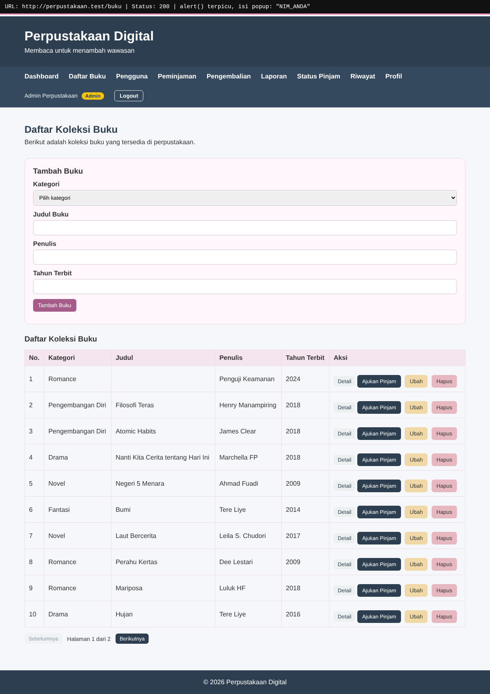 |
| A2 — `/buku-cari?judul=' OR '1'='1` menampilkan seluruh data buku | 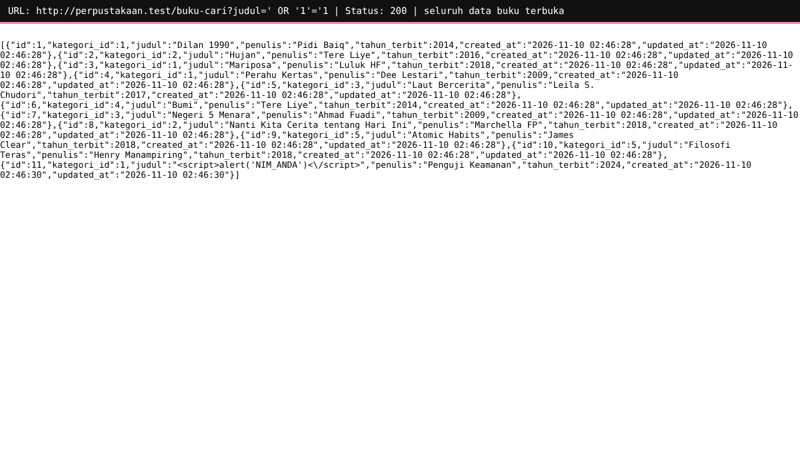 |
| A3 — `jebakan.html` (di luar proyek) | 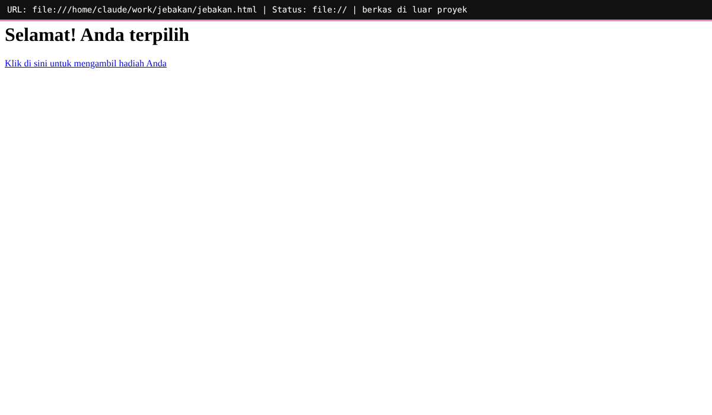 |
| A3 — setelah tautan diklik saat login sebagai admin: `/buku/5/hapus` → 200, buku terhapus | 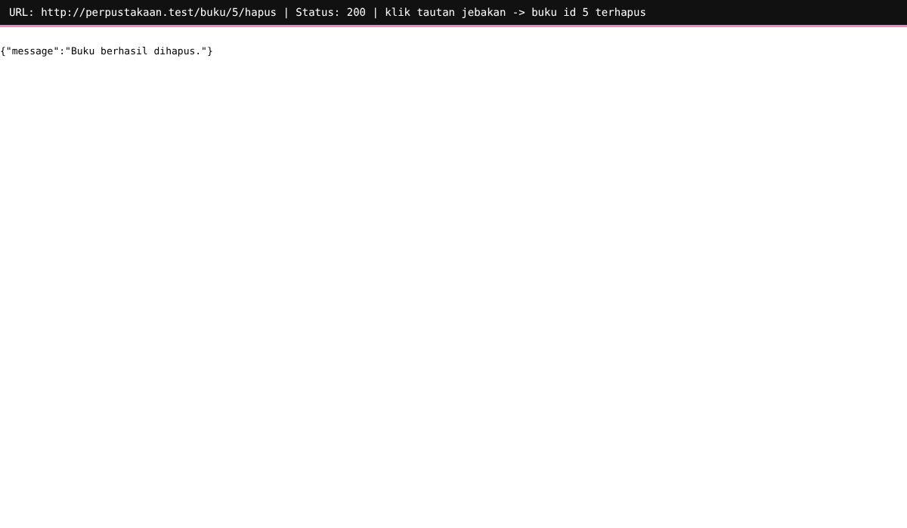 |
| A3 — buku id 5 hilang (`/api/buku/5` → 404) | 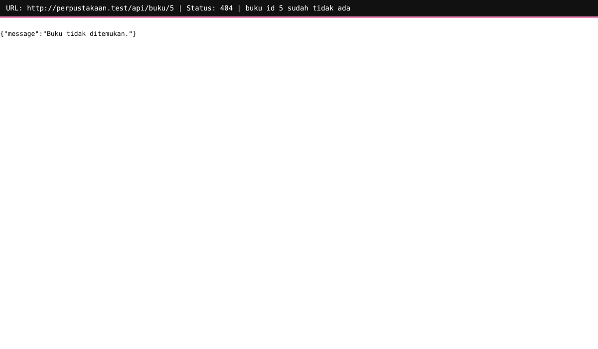 |
| A4 — siswa1 membuka `/peminjaman/7` milik siswa2 → 200, data tampil | 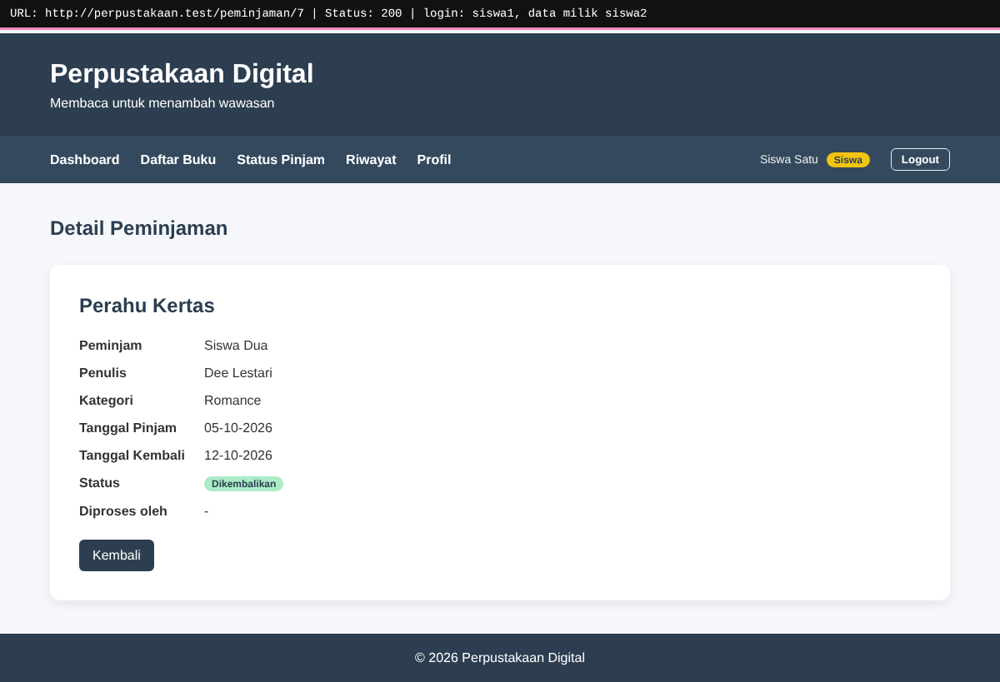 |

### Penjelasan

- **A1 (XSS tersimpan).** `{!! !!}` mencetak string apa adanya sebagai HTML. Judul yang berisi `<script>` disimpan di database lalu dieksekusi browser setiap orang yang membuka daftar buku. Dampak: pencurian sesi/cookie, tindakan atas nama korban, pengalihan ke situs palsu, dan pengubahan tampilan halaman.
- **A2 (SQL Injection).** Nilai `judul` disambung langsung ke string SQL sehingga input dapat mengubah struktur query. `' OR '1'='1` membuat kondisi selalu benar dan seluruh baris keluar. Dampak: pembacaan seluruh tabel (termasuk tabel `users`/hash password dengan `UNION`), pengubahan/penghapusan data, bergantung hak akun database.
- **A3 (CSRF).** Penghapusan memakai GET tanpa token. Browser otomatis menyertakan cookie sesi pada navigasi tingkat atas, sehingga satu klik pada tautan di situs lain membuat server menganggap permintaan itu sah. Dampak: admin/petugas yang login dapat dipaksa menghapus data tanpa sadar. GET juga seharusnya *safe* (tidak mengubah data).
- **A4 (IDOR / Broken Object Level Authorization).** Server hanya memeriksa "sudah login", tidak memeriksa apakah data milik pengguna itu. Siswa cukup mengganti angka id pada URL. Dampak: kebocoran data pribadi dan riwayat pinjam siswa lain.

---

## Soal 2 — Menambal A1, A2, A3 (commit "Soal 2")

### Source Code

**(a) Escaping Blade**

```blade
{{-- sebelumnya --}}  <td>{!! $buku->judul !!}</td>
{{-- sesudah --}}     <td>{{ $buku->judul }}</td>
```

**(b) Query dengan binding**

```php
// sebelumnya
$hasil = DB::select("SELECT * FROM bukus WHERE judul = '$judul'");
// sesudah
$hasil = DB::select('SELECT * FROM bukus WHERE judul = ?', [$judul]);
```

**(c) Hapus lewat DELETE + CSRF**

```php
// sebelumnya (dihapus)
Route::get('/buku/{buku}/hapus', [\App\Http\Controllers\Api\BukuController::class, 'destroy']);

// sesudah
Route::delete('/buku/{buku}', [BukuController::class, 'destroy'])
    ->middleware('permission:kelola data buku')->name('buku.destroy');
```

```php
// BukuController
public function destroy(Buku $buku)
{
    $judul = $buku->judul;

    try {
        $buku->delete();
    } catch (QueryException) {
        return back()->with('error', "Buku \"{$judul}\" masih memiliki data peminjaman sehingga tidak dapat dihapus.");
    }

    return redirect()->route('buku.index')->with('success', "Buku \"{$judul}\" berhasil dihapus.");
}
```

```blade
<form method="POST" action="{{ route('buku.destroy', $buku) }}" class="inline-form"
      onsubmit="return confirm(@js('Apakah kamu yakin ingin menghapus buku "'.$buku->judul.'"?'))">
    @csrf
    @method('DELETE')
    <button type="submit" class="btn-delete">Hapus</button>
</form>
```

### Hasil

| Sub-butir | Tangkapan layar |
|-----------|-----------------|
| (a) judul payload tampil sebagai teks, tanpa popup | 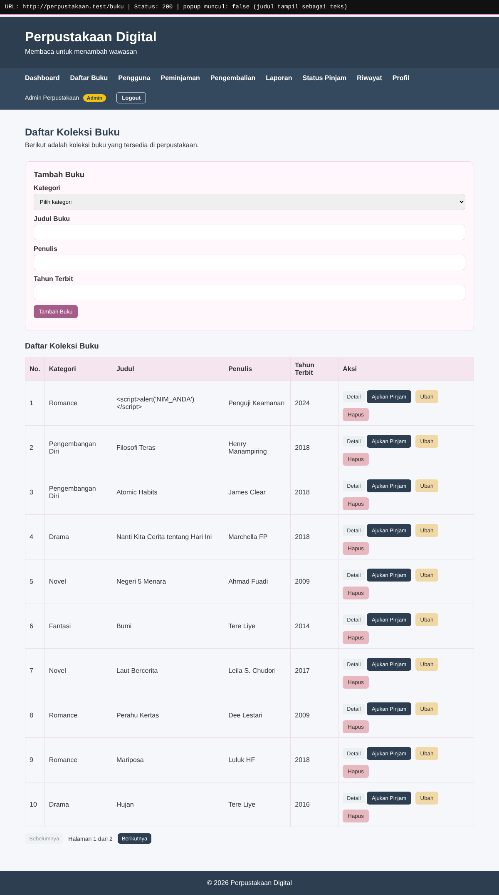 |
| (b) `/buku-cari?judul=' OR '1'='1` → `[]` | 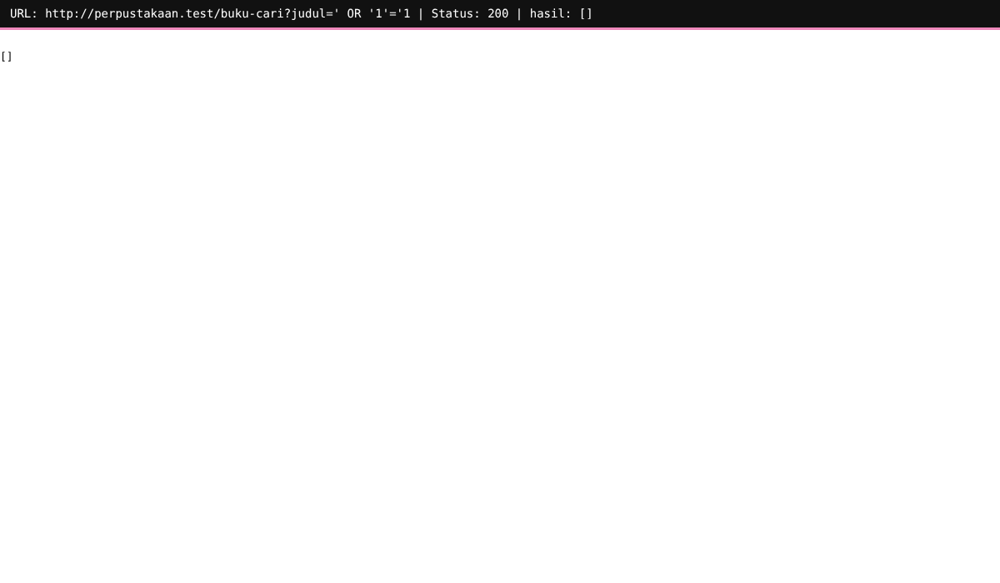 |
| (c) tautan `jebakan.html` → `/buku/5/hapus` → 404, buku tidak terhapus | 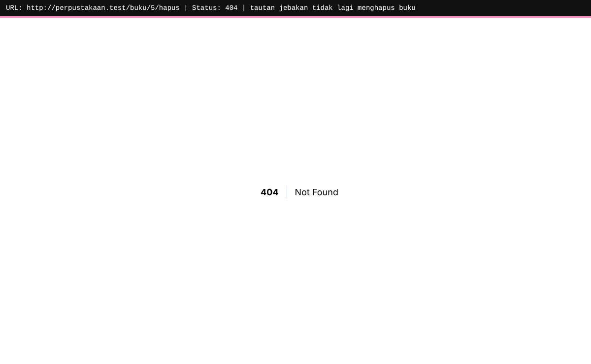 |
| (c) tombol Hapus pada aplikasi tetap berhasil | 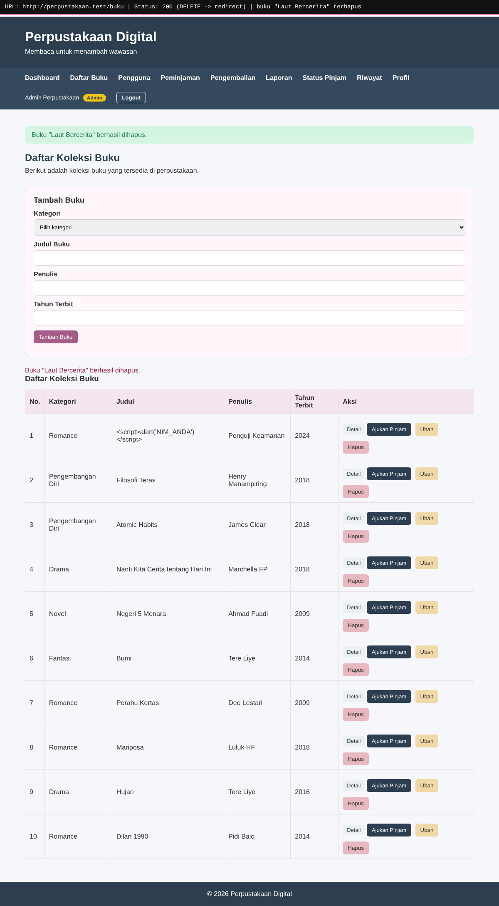 |
| (c) DELETE `/buku/{id}` tanpa cookie/token → 419 | 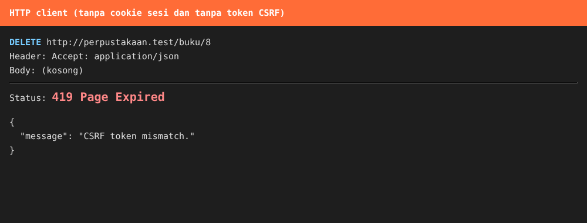 |

### Penjelasan

- **(a)** `{{ }}` memanggil `e()` yang mengubah `<`, `>`, `"`, `'`, `&` menjadi entitas HTML; browser menampilkan teks, bukan menjalankan tag.
- **(b)** Dengan `?` + array binding, nilai dikirim sebagai parameter terpisah dari teks SQL. Isi `' OR '1'='1` hanya dibandingkan sebagai string judul, sehingga tidak ada buku yang cocok → `[]`.
- **(c)** Route GET dihapus, sehingga tautan lintas situs tidak punya target (404). Route DELETE hanya dapat dicapai lewat form yang menyertakan `@csrf` (token) dan `@method('DELETE')`; situs penyerang tidak bisa mengetahui token sesi korban, dan tautan `<a>` hanya bisa mengirim GET. Permintaan tanpa token ditolak middleware CSRF dengan 419.

---

## Soal 3 — Gate `kelola-buku` (commit "Soal 3")

### Source Code

```php
// app/Providers/AppServiceProvider.php
Gate::define('kelola-buku', fn (User $user) => $user->hasAnyRole([User::ROLE_ADMIN, User::ROLE_PETUGAS]));
```

```php
// routes/web.php  (didaftarkan sebelum /buku/{id})
Route::middleware(['auth', 'can:kelola-buku'])->group(function () {
    Route::get('/buku/create', [BukuController::class, 'create'])->name('buku.create');
    Route::post('/buku', [BukuController::class, 'store'])->name('buku.store');
    Route::get('/buku/{buku}/edit', [BukuController::class, 'edit'])->name('buku.edit');
    Route::put('/buku/{buku}', [BukuController::class, 'update'])->name('buku.update');
    Route::delete('/buku/{buku}', [BukuController::class, 'destroy'])->name('buku.destroy');
});
```

```php
// routes/api.php: permission:kelola data buku  →  can:kelola-buku
Route::middleware('can:kelola-buku')->group(function () { /* POST/PUT/DELETE api/buku */ });
```

```blade
{{-- resources/views/buku/index.blade.php --}}
@can('kelola-buku')
    <p><a href="{{ route('buku.create') }}" class="btn">Tambah Buku</a></p>
@endcan
...
@can('kelola-buku')
    <a href="{{ route('buku.edit', $buku) }}" class="btn btn-light btn-sm">Ubah</a>
    <form method="POST" action="{{ route('buku.destroy', $buku) }}"> @csrf @method('DELETE') ... </form>
@endcan
```

Form tambah/ubah dipindah ke `buku/create.blade.php` dan `buku/edit.blade.php` (dengan `StoreBukuRequest`/`UpdateBukuRequest`). Menu dashboard memakai `@can('kelola-buku')`.

### Hasil

| Keterangan | Tangkapan layar |
|------------|-----------------|
| Siswa mengetik `/buku/create` → 403 Forbidden | 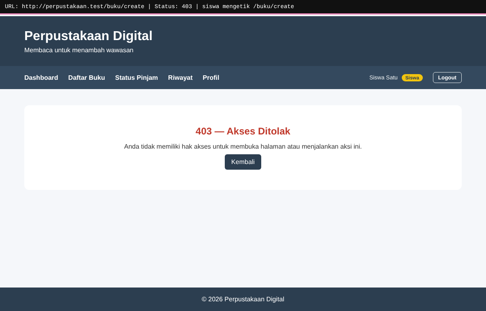 |
| Daftar buku akun siswa: tombol Tambah/Ubah/Hapus tidak tampil | 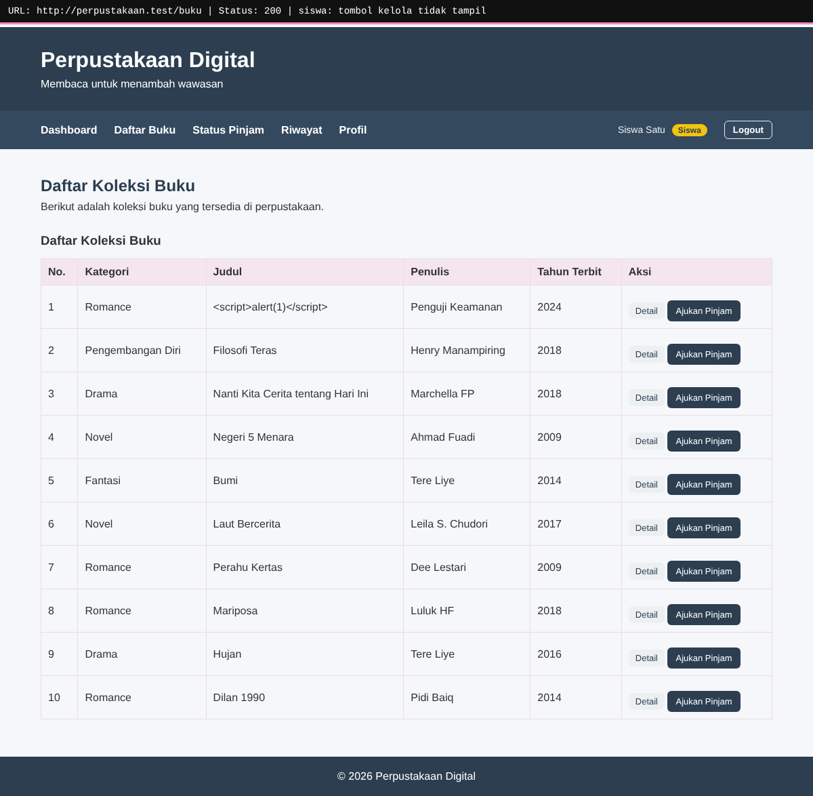 |
| Daftar buku akun petugas: tombol tampil | 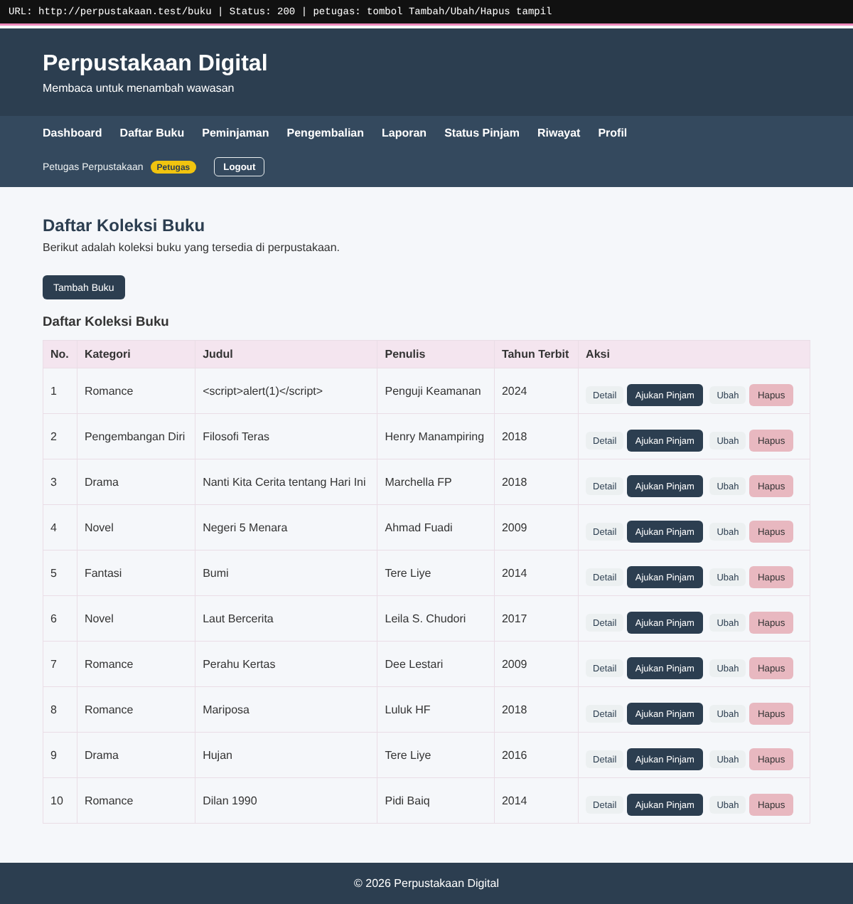 |
| Admin membuka form tambah buku (200) | 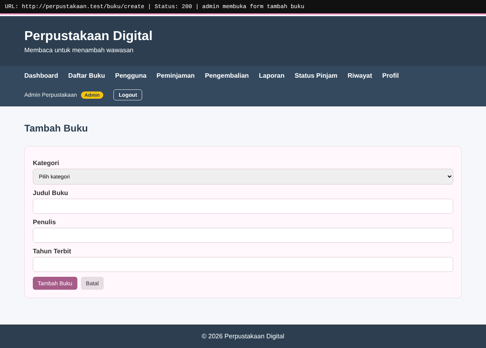 |

Admin dan petugas dapat membuka form, mengubah, dan menghapus (juga diuji otomatis di `tests/Feature/KeamananTest.php`).

### Penjelasan

Pemeriksaan role/permission langsung pada route membuat aturan "siapa boleh mengelola buku" tersebar dan harus diulang di tiap route, API, dan view; mengubah aturan (misalnya menambah role) berarti mengedit banyak tempat dan mudah ada yang terlewat. Gate memberi **satu definisi** bernama (`kelola-buku`) yang dipakai ulang oleh `can:` pada route, `@can` pada tampilan, dan `Gate::allows/authorize` pada kode. Route hanya menyatakan "butuh kemampuan X", tidak peduli bagaimana X ditentukan. Gate juga dapat menerima konteks tambahan (model, kepemilikan), sedangkan pemeriksaan role pada route hanya melihat peran. Tombol yang disembunyikan hanyalah kenyamanan tampilan; penegakan sesungguhnya tetap di server (403).

---

## Soal 4 — PeminjamanPolicy (commit "Soal 4")

### Source Code

```php
// app/Policies/PeminjamanPolicy.php  (dikenali otomatis: App\Policies\{Model}Policy)
public function view(User $user, Peminjaman $peminjaman): bool
{
    if ($user->hasAnyRole([User::ROLE_ADMIN, User::ROLE_PETUGAS])) {
        return true;
    }

    return $peminjaman->anggota?->user_id === $user->id;
}
```

```php
// PeminjamanController@show setelah diperbaiki
public function show($id)
{
    $peminjaman = Peminjaman::findOrFail($id);

    Gate::authorize('view', $peminjaman);

    return view('peminjaman.show', ['peminjaman' => $peminjaman->load(['anggota', 'buku.kategori', 'pemroses'])]);
}
```

Potongan yang dihapus/diganti dari Modul 5: `PeminjamanPolicy` Modul 5 memakai `$peminjaman->dimilikiOleh($user) || $user->can('kelola peminjaman')`;
diganti dengan Policy di atas (admin/petugas dicek lewat role, siswa lewat `anggota->user_id`). Pada Modul 5 tidak ada pemeriksaan kepemilikan manual di controller (sudah `Gate::authorize`); kode rentan Soal 1 (`show($id)` tanpa pemeriksaan) kini menggunakan `Gate::authorize`. Method `dimilikiOleh()` pada model tetap dipakai oleh alur setujui/tolak/kembali (petugas tidak boleh memproses peminjamannya sendiri).

### Hasil

| Akun | Tangkapan layar |
|------|-----------------|
| Siswa pemilik (siswa1, `/peminjaman/5`) → 200 | 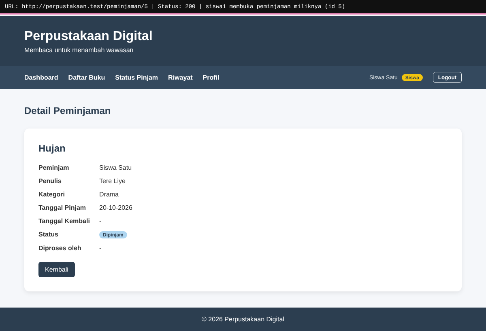 |
| Siswa lain (siswa1 membuka `/peminjaman/7`) → 403 | 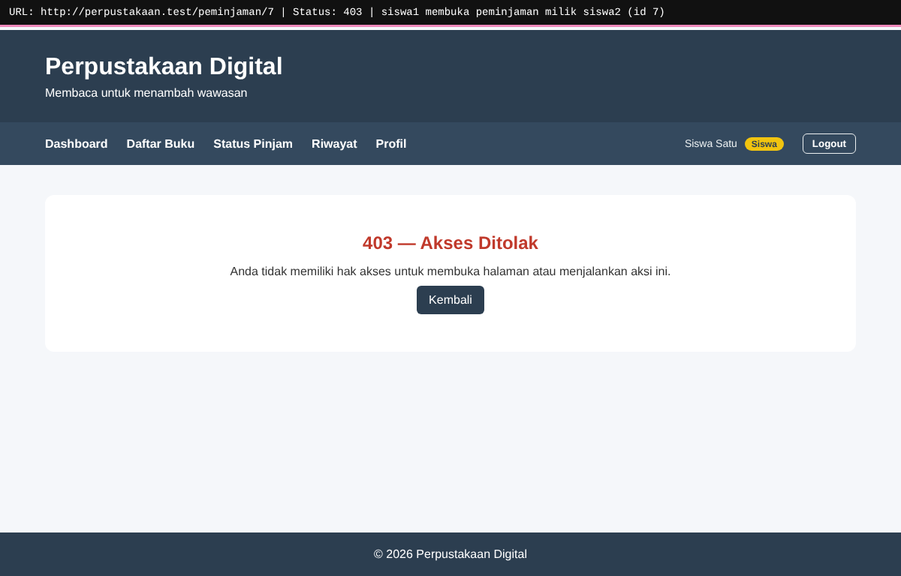 |
| Petugas (`/peminjaman/7`) → 200 | 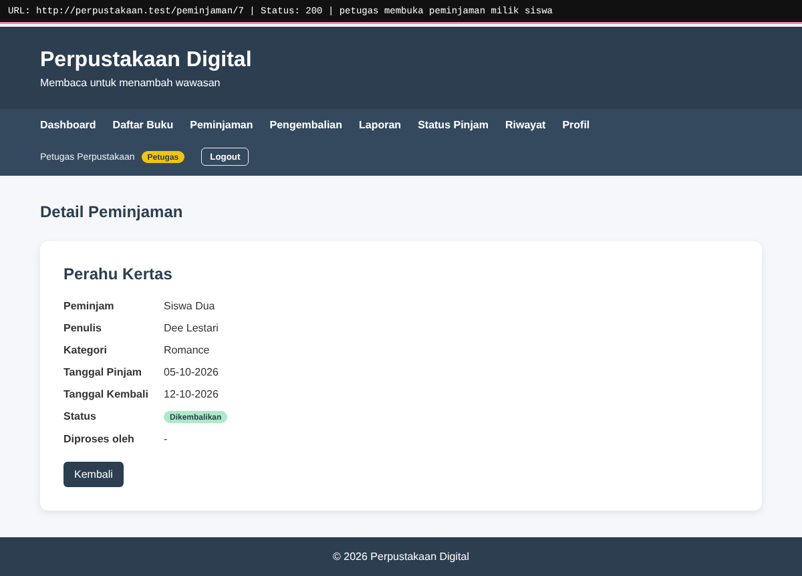 |

### Penjelasan

Pemeriksaan role hanya menjawab "siapa kamu" (siswa/petugas), bukan "apakah **objek ini** milikmu". Dua siswa sama-sama berrole `siswa` dan sama-sama lolos pemeriksaan role, jadi siswa A tetap bisa membuka peminjaman siswa B hanya dengan mengganti id (IDOR). Pencegahannya harus memeriksa hubungan antara pengguna dan objek (`peminjaman->anggota->user_id === user->id`) pada setiap akses; Policy memusatkan pemeriksaan tingkat-objek tersebut.

---

## Soal 5 — Penguatan konfigurasi dan pengujian

### Source Code

**`.env` (tanpa `APP_KEY` dan password database)**

```dotenv
APP_NAME=Laravel
APP_ENV=local
APP_DEBUG=false
APP_URL=http://localhost:8000
...
ADMIN_PASSWORD=<password kuat, tidak dikomit>
```

`.env.example`: `APP_ENV=production`, `APP_DEBUG=false`, `ADMIN_PASSWORD=` (kosong).

**Seeder** (`database/seeders/UserSeeder.php`)

```php
$passwordAdmin = env('ADMIN_PASSWORD');

if (blank($passwordAdmin)) {
    $passwordAdmin = Str::password(20);
    $this->command?->warn("ADMIN_PASSWORD kosong; password admin acak: {$passwordAdmin}");
}

foreach ($akun as [$nama, $email, $role]) {
    if ($role === User::ROLE_ADMIN) {
        // updateOrCreate: admin lama berpassword "password" ikut diganti saat seeding ulang
        $user = User::updateOrCreate(['email' => $email], ['name' => $nama, 'password' => $passwordAdmin]);
    } else {
        $user = User::firstOrCreate(['email' => $email], ['name' => $nama, 'password' => 'password']);
    }
    ...
}
```

Akun petugas dan siswa demo tetap berpassword `password` agar skenario uji dapat dijalankan (hanya untuk lokal).

### Hasil

| Butir | Tangkapan layar |
|-------|-----------------|
| (a) route sementara melempar `RuntimeException`, `APP_DEBUG=true` (sebelum): jejak kode terbuka | 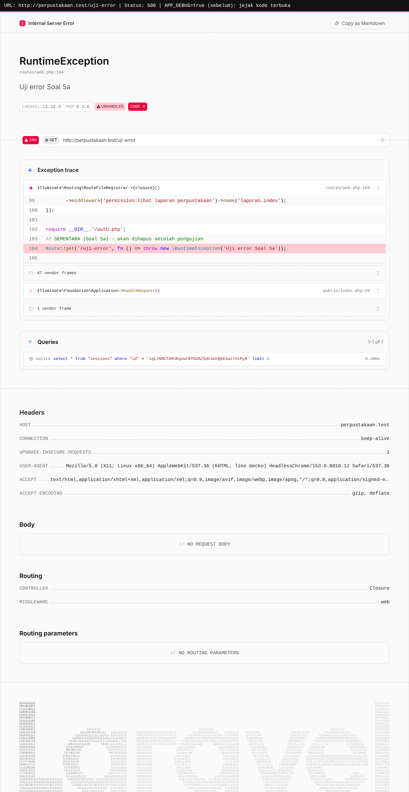 |
| (a) `APP_DEBUG=false`: hanya "500 Server Error" (route sementara kemudian dihapus) | 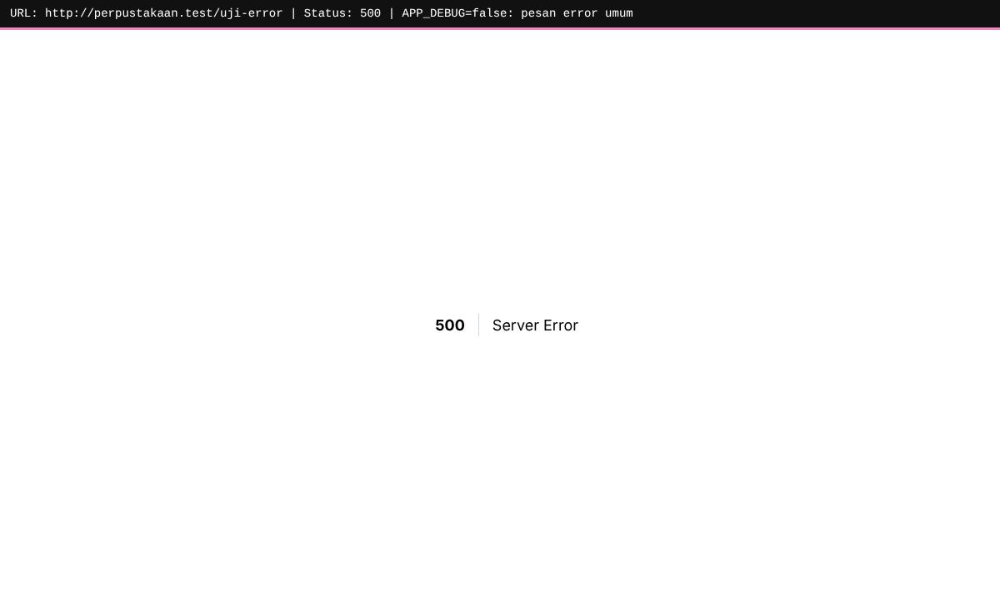 |
| (b) `http://perpustakaan.test/.env` → 404 | 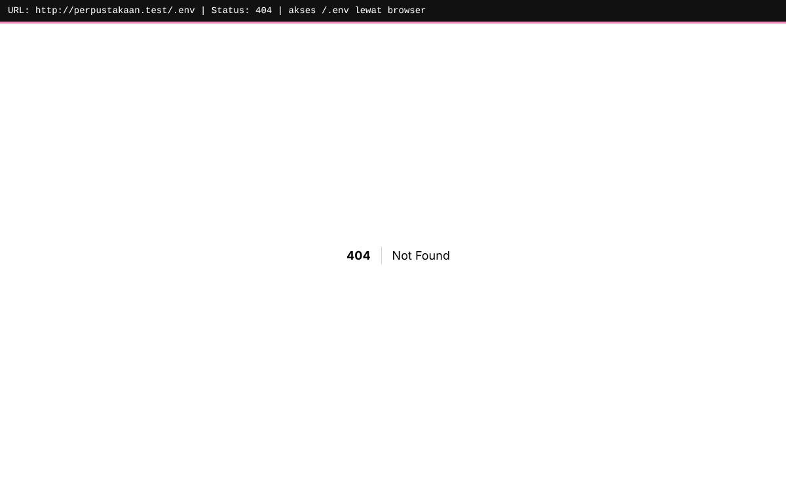 |
| (c) login admin dengan `password` ditolak (kembali ke `/login`) | 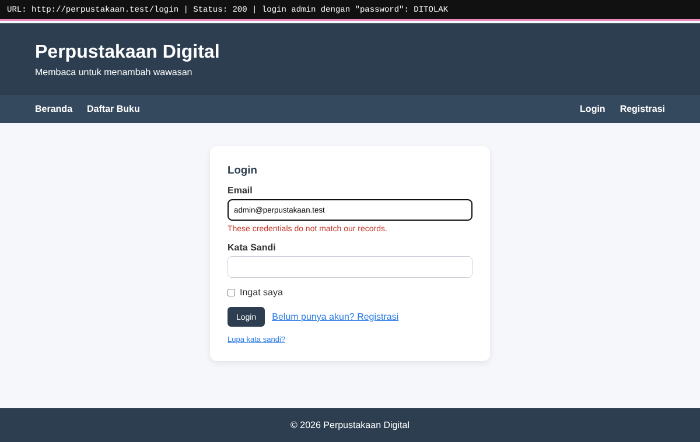 |

### Tabel pengujian

| No | Role | Skenario | Hasil yang Diharapkan | Hasil Aktual |
|----|------|----------|-----------------------|--------------|
| 1 | Belum login | Membuka `/peminjaman/1` | Dialihkan ke halaman login | Dialihkan ke `/login` ([gambar](laporan/img/soal5_t01_guest.png)) ✔ |
| 2 | Admin | Menambah buku `<script>alert(1)</script>` | Judul tampil sebagai teks, tanpa popup | Judul tampil sebagai teks, tanpa popup ([gambar](laporan/img/soal5_t02_xss_admin.png)) ✔ |
| 3 | Admin | `/buku-cari?judul=' OR '1'='1` | Hasil kosong `[]` | 200, `[]` ([gambar](laporan/img/soal5_t03_sqli.png)) ✔ |
| 4 | Admin | DELETE `/buku/{id}` tanpa token | 419 Page Expired | 419, `CSRF token mismatch.` ([gambar](laporan/img/soal5_t04_delete_tanpa_token.png)) ✔ |
| 5 | Admin | Hapus buku lewat tombol Hapus | Buku terhapus | Buku "Atomic Habits" berhasil dihapus ([gambar](laporan/img/soal5_t05_tombol_hapus.png)) ✔ |
| 6 | Admin | Membuka tautan `jebakan.html` saat login | Buku tidak terhapus (404/405) | 404; buku id 5 masih ada ([gambar](laporan/img/soal5_t06_jebakan.png)) ✔ |
| 7 | Siswa | Membuka `/buku/create` langsung | 403 Forbidden, tombol kelola tidak tampil | 403; tombol Tambah/Ubah/Hapus tidak tampil ([gambar](laporan/img/soal3_siswa_403.png)) ✔ |
| 8 | Siswa | Peminjaman milik sendiri | 200, data tampil | 200, data tampil ✔ |
| 9 | Siswa | Peminjaman milik siswa lain | 403 Forbidden | 403 Forbidden ✔ |
| 10 | Petugas | Peminjaman siswa mana pun | 200, data tampil | 200, data tampil ✔ |
| 11 | Semua | Halaman error dengan `APP_DEBUG=false` | Pesan error umum tanpa jejak kode | "500 Server Error", tanpa nama kelas/jalur berkas ✔ |
| 12 | Semua | `/.env` dan login admin dengan `password` | 404/403; login ditolak | `/.env` → 404; login ditolak ✔ |

### Penjelasan risiko

- **`APP_DEBUG=true`**: halaman error menampilkan jejak kode, jalur berkas, query SQL, dan nilai konfigurasi (termasuk potongan `.env`), sehingga membantu penyerang memetakan aplikasi dan mencuri rahasia. Di produksi harus `false`; kesalahan dicatat di log, pengguna hanya melihat pesan umum.
- **`.env` dapat dibuka**: berisi `APP_KEY` (dapat memalsukan cookie/sesi terenkripsi), kredensial database, dan kunci layanan. Hanya folder `public/` yang boleh menjadi document root web server; `.env` di luar `public/` dan tidak boleh di-commit.
- **Password bawaan seeder**: akun admin berpassword `password` dapat ditebak siapa pun dan memberi kendali penuh. Password admin kini dari `ADMIN_PASSWORD` di `.env` (atau acak), dan password lama tidak lagi berlaku.

---

## Pengujian otomatis

`php artisan test` → `tests/Feature/KeamananTest.php` (7 pengujian: escaping, SQLi, GET hapus 404, Gate, 403 siswa, CRUD admin/petugas, Policy IDOR) lulus. Empat pengujian lama Modul 5 (`ExampleTest::test_beranda...`, `RbacTest::test_skenario_1...`, `test_api_buku_tanpa_login_ditolak`, `test_user_tanpa_role_tidak_punya_akses_apa_pun`) sudah gagal pada kondisi awal Modul 5 (halaman beranda dan daftar buku dibuat publik) dan tidak diubah. Dua pengujian tampilan di `RbacTest` disesuaikan dengan markup daftar buku yang baru.
